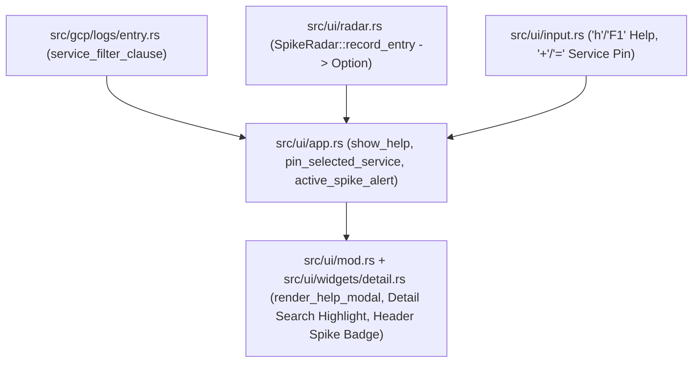

# Technical Specification: Phase 3 Help Modal, Spike Alerting, Service Pin & Release Prep

## Architecture & Component Flow

## Detailed Design

### 1. Help Modal (`h` / `F1` key) (`src/ui/app.rs`, `src/ui/input.rs`, `src/ui/widgets/detail.rs`, `src/ui/mod.rs`)
- Add `pub show_help: bool` to `App` (default `false`) and `pub fn toggle_help(&mut self)`.
- When `app.show_help` is `true`, pressing `Esc`, `h`, or `F1` closes the help modal.
- Render `render_help_modal(frame, app, area)` over the main workspace area when `app.show_help` is `true`, listing all shortcuts in 5 sections:
  - Navigation & Panes (`j/k`, `g/G`, `Tab/Shift+Tab`, `z`, `Ctrl+j/k`, `Ctrl+n/p`)
  - Incident Triage & Context (`c`, `Enter`, `s`, `[/]`, `x`)
  - Filtering & Noise Control (`f`, `b`, `+`, `-`, `/`, `n/N`, `Esc`)
  - AI Root Cause Analysis (`e`, `E`, `?`, `m`)
  - Export & External Actions (`w`, `y`, `Y`, `o`, `p`, `t`, `q`)

### 2. Real-Time Spike & New Error Alerting (`src/ui/radar.rs`, `src/ui/app.rs`, `src/ui/mod.rs`)
- Define `SpikeAlert` in `src/ui/radar.rs`:
  - `NewErrorPattern { severity: String, fingerprint: String }` (emitted when a new cluster has `severity` in `ERROR`, `CRITICAL`, `ALERT`, `EMERGENCY`)
  - `SpikeThresholdCrossed { severity: String, fingerprint: String, count: usize }` (emitted when an existing cluster transitions from `!was_spike` to `is_spike`)
- Update `SpikeRadar::record_entry(&mut self, entry: &LogEntry) -> Option<SpikeAlert>`.
- In `App`:
  - Add `pub active_spike_alert: Option<String>` and `pub pending_bell: bool`.
  - In `App::add_log`, if `self.radar.record_entry(&entry)` returns `Some(alert)`, set `self.active_spike_alert = Some(alert.summary())` and `if self.is_streaming { self.pending_bell = true; }`.
  - Add `App::take_pending_bell(&mut self) -> bool` and `App::dismiss_spike_alert(&mut self)`.
  - Opening Radar (`c`) or pressing `Esc` clears `active_spike_alert`.

### 3. 1-Keystroke Service / Resource Filter Pin (`+` / `=` key) & Detail Search Highlighting (`src/gcp/logs/entry.rs`, `src/ui/app.rs`, `src/ui/input.rs`, `src/ui/widgets/detail.rs`)
- In `src/gcp/logs/entry.rs`:
  - `pub fn service_filter_clause(&self) -> Option<(String, String)>`: checks `resource.labels` (`service_name`, `container_name`, `function_name`, `job_name`, `pod_name`, `revision_name`, `database_id`, `instance_id`), then `labels` (`k8s-pod/app`, `service`, `app`), then `resource.type`, returning `(gcp_filter_clause, short_badge)`.
- In `src/ui/app.rs` & `src/ui/input.rs`:
  - Add `pub active_service_pin: bool` to `App` and `pub fn pin_selected_service(&mut self) -> Result<String, String>`.
  - Pressing `+` or `=` when `active_surrounding.is_none()` calls `app.pin_selected_service()` and returns `Action::ApplyFilter(Some(new_filter))`.
  - Pressing `Esc` exits `active_service_pin` and restores `previous_filter`.
- In `src/ui/widgets/detail.rs`:
  - When `app.search_query` is `Some(ref q)`, highlight lines containing `q` (case-insensitive) in `render_detail_pane`.
