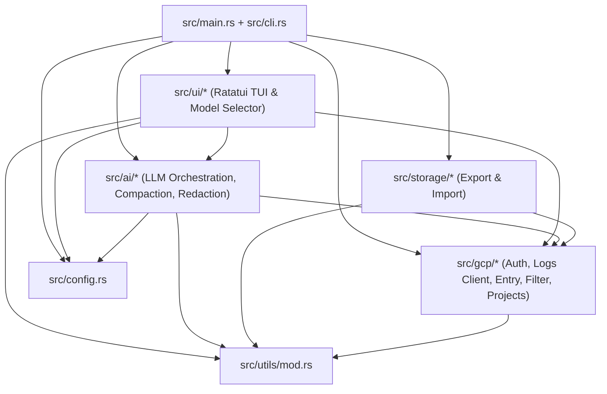

# Technical Specification: 3-Phase Architecture Refactoring

## Architecture Dependency Graph (Target State)

## Phase 1: P0 Bug Fixes & Runtime Hardening
1. **`StreamHandle` Lifecycle (`src/gcp/logs/client.rs`, `src/ui/app.rs`, `src/ui/mod.rs`, `src/main.rs`)**:
   - Implement `Drop` for `StreamHandle` (`let _ = self.stop_tx.try_send(());`).
   - Add `stream_handle: Option<StreamHandle>` field to `App` (with `.with_stream_handle(handle)` builder and `.set_stream_handle(...)`).
   - In `main.rs` (`handle_tail`), pass the initial `StreamHandle` into `app.with_stream_handle(handle)`.
   - In `restart_live_stream` (`src/ui/mod.rs`), store `app.stream_handle = Some(new_handle)` when starting a new stream, and set `app.stream_handle = None` when switching to static Surrounding snapshot mode (`s`), ensuring old streams stop immediately and new streams stay alive.
2. **Quote-Aware & Boolean-Aware Local Filter (`src/gcp/logs/filter.rs`)**:
   - Implement `tokenize_filter_expr(expr: &str) -> Vec<String>` supporting quoted strings (`"..."`, `'...'`), stripping outer parentheses, ignoring `AND` / `OR` keywords, supporting `NOT` / `-` negation, and supporting `:` substring / `=~` regex operators.
   - Add helper `is_local_only_filter(expr: &str) -> bool` (detecting `fingerprint:...`) so `restart_live_stream` does not send local-only pseudo-filters to GCP's REST API.
3. **Radar Drill-Down Filter Restoration (`src/ui/app.rs`, `src/ui/input.rs`)**:
   - Save `self.previous_filter` when `drill_into_selected_cluster` is invoked, and restore `previous_filter` when pressing `Esc`.
4. **Respect `ExportOptions.format` (`src/storage/export.rs`, `src/main.rs`)**:
   - Use `options.format` in `export_logs` instead of unconditionally overwriting it with `ExportFormat::from_path(output_path)`.
   - In `handle_download`, infer format from `--output` path when constructing `ExportOptions`.
5. **Default HTTP Timeouts & Regex Pre-compilation (`src/utils/mod.rs`)**:
   - Add `default_http_client() -> reqwest::Client` with `connect_timeout(10s)` and `timeout(30s)`.
   - Use `OnceLock<Regex>` in `fix_relative_timestamps`.

## Phase 2: P1 Architectural Decoupling & Deduplication
1. **Decouple `ai` from `ui`**:
   - Move `fingerprint_message` to `src/utils/mod.rs` (and re-export from `src/ui/radar.rs` and `src/ui/mod.rs`).
   - Move `src/ai/selector.rs` implementation to `src/ui/selector.rs` and re-export from `src/ai/selector.rs` / `src/ai/mod.rs`.
2. **Unify `ProviderKind` & Project ID Parsing (`src/config.rs`, `src/gcp/logs/client.rs`)**:
   - Use `ProviderKind::try_parse(provider)` in `Config::get_provider_api_key` and `Config::get_provider_base_url`.
   - Centralize `extract_first_gcp_project_id` in `src/gcp/logs/client.rs` (re-exported in `gcp` and `ai::gemini`).
   - Remove legacy `fn get_api_key()` from `src/ai/gemini.rs`.
3. **Unify `RacoonError` (`src/error.rs`)**:
   - Add `Projects(#[from] ProjectsError)`, `ConfigError(#[from] ConfigError)`, `Export(#[from] ExportError)`, `Import(#[from] ImportError)` variants to `RacoonError`.

## Phase 3: P2 Modular File Splitting
1. **`src/gcp/logs/`**:
   - `mod.rs`: Re-exports & integration tests
   - `client.rs`: `LogsClient`, `StreamHandle`, `StreamDeduplicator`, `poll_logs`, `parse_resource_names`, `extract_first_gcp_project_id`
   - `entry.rs`: `LogEntry`, `MonitoredResource`, `HttpRequest`, correlation/surrounding/URL methods
   - `filter.rs`: `LogFilter`, `matches_local_filter`, `tokenize_filter_expr`, `severity_rank`
2. **`src/ai/`**:
   - `cache.rs`: `AiResponseCache`
   - `providers.rs`: Provider wire structs & HTTP generation methods (`generate_google`, `generate_vertex`, `generate_openai_compatible`, `generate_anthropic`)
   - `gemini.rs`: `GeminiClient` / `AiClient` high-level API & unit tests
   - `prompts.rs`: Add `detect_intent_prompt`
3. **`src/ui/app.rs` & `src/main.rs`**:
   - Slim down `src/ui/app.rs` by delegating filter logic to `crate::gcp::logs::filter` and unifying context-mode state transitions.
   - Extract `init_verified_auth` and `resolve_project` helpers in `src/main.rs`.
