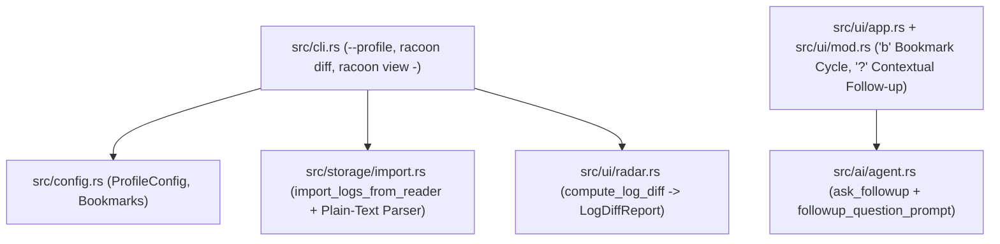

# Technical Specification: Phase 2 Profiles, Contextual AI, Stdin Pipe & Release Diff

## Architecture & Component Flow

## Detailed Design

### 1. Named Profiles & Filter Bookmarks (`src/config.rs`, `src/cli.rs`, `src/ui/app.rs`, `src/ui/input.rs`)
- In `src/config.rs`:
  - `ProfileConfig`: `project: Option<String>`, `impersonate_service_account: Option<String>`, `filter: Option<String>`, `severity: Option<String>`, `since: Option<String>`.
  - Add `#[serde(default)] pub profiles: BTreeMap<String, ProfileConfig>` and `#[serde(default)] pub bookmarks: BTreeMap<String, String>` to `Config`.
  - `Config::apply_profile(&mut self, name: &str) -> Result<ProfileConfig, String>`: merges the profile into `self.defaults` and returns the resolved `ProfileConfig`.
  - `Config::effective_bookmarks(&self) -> Vec<(String, String)>`: returns user bookmarks from `self.bookmarks` followed by built-in SRE bookmarks (deduplicated by name).
- In `src/ui/app.rs` & `src/ui/input.rs`:
  - Add `pub bookmarks: Vec<(String, String)>` and `pub bookmark_index: Option<usize>` to `App`.
  - `App::cycle_next_bookmark(&mut self) -> Option<(String, String)>`: advances `bookmark_index`, calls `self.clear_context_overlay()`, `self.set_filter(Some(filter.clone()))`, sets `status_message` (`"🔖 Bookmark [i/n] <name>: <filter>"`), and returns `Some((name, filter))`.
  - Pressing `b` in Normal mode calls `app.cycle_next_bookmark()` and returns `Action::ApplyFilter(Some(filter))`.

### 2. Contextual AI Multi-Turn Follow-up (`src/ai/prompts.rs`, `src/ai/agent.rs`, `src/ui/mod.rs`)
- In `src/ai/prompts.rs`:
  - Add `pub fn followup_question_prompt(question: &str, previous_analysis: &str, logs_context: &str) -> String`.
- In `src/ai/agent.rs`:
  - Add `pub async fn ask_followup(&self, question: &str, previous_analysis: &str, selected_log: Option<&LogEntry>, local_logs: &[LogEntry]) -> Result<String, AiError>`.
  - Compacts `selected_log` (if present) or `local_logs` using `compact_log_for_ai` / `compact_logs_for_rca`, applies `redact_sensitive_text` when `self.redact_pii` is enabled, and queries the active provider.
- In `src/ui/mod.rs`:
  - Extend `AiRequest::AskQuestion` with `previous_analysis: Option<String>` and `selected_log: Option<Box<LogEntry>>`.
  - When `detect_intent` returns `UserIntent::Question`: if `previous_analysis.is_some()` or `worker_logs_client.is_none()`, use `client.ask_followup(...)` to provide a context-aware answer!

### 3. Stdin Pipe (`racoon view -`) & Plain-Text Log Parser (`src/storage/import.rs`, `src/main.rs`)
- In `src/storage/import.rs`:
  - Add `pub fn import_logs_from_str(content: &str, source_label: &str) -> Result<ImportResult, ImportError>` and `pub fn parse_plain_text_log_line(line: &str) -> LogEntry`.
  - `import_logs` delegates to `import_logs_from_str` (or reader) and supports JSON arrays, wrapped JSON, NDJSON, and plain-text log files/streams seamlessly!
  - In `src/main.rs` (`handle_view`): if `args.file == "-"`, read from `std::io::stdin()` into `import_logs_from_str(&buf, "stdin")`.

### 4. Post-Deployment Error Fingerprint Diff (`racoon diff`) (`src/ui/radar.rs`, `src/cli.rs`, `src/main.rs`)
- In `src/ui/radar.rs`:
  - Define `DiffPatternEntry { fingerprint, severity, baseline_count, current_count, sample_message }` and `LogDiffReport { baseline_total_logs, current_total_logs, baseline_error_logs, current_error_logs, new_patterns, regressed_patterns, resolved_patterns, unchanged_patterns }`.
  - Implement `pub fn compute_log_diff(baseline: &[LogEntry], current: &[LogEntry]) -> LogDiffReport` and `LogDiffReport::format_report(&self) -> String`.
- In `src/cli.rs` & `src/main.rs`:
  - Add `Commands::Diff(DiffArgs)` supporting `--baseline-file` + `--current-file` (offline comparison) OR `--project` + `--baseline` + `--current` (live GCP window comparison, e.g. `2h..1h` vs `1h..now`), plus `--json` and `--ai`.
