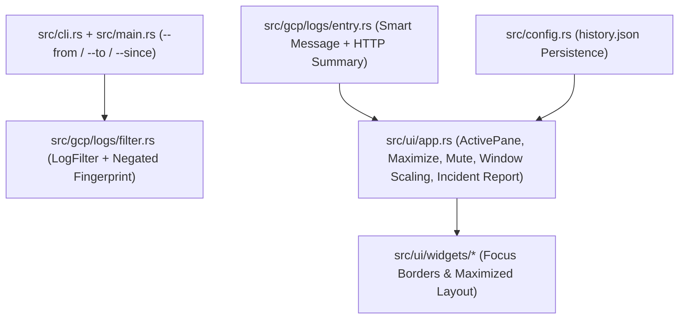

# Technical Specification: Phase 1 On-Call UX & High-ROI Features

## Architecture & Data Flow

## Detailed Design

### 1. Smart Log Message & HTTP Summary (`src/gcp/logs/entry.rs`)
- In `LogEntry::message(&self) -> String`:
  1. If `self.text_payload` is `Some(text)` and `!text.trim().is_empty()`, return `text.clone()`.
  2. If `self.json_payload` is `Some(Value::Object(map))`:
     - Check string fields in order: `["message", "msg", "event", "error", "err", "reason", "description", "detail"]`.
     - If `"error"` or `"err"` is a nested JSON object containing `"message"` or `"msg"`, extract that string.
     - If an extracted message is found and `self.http_request` also has a status/method, or if no extracted message is found:
       - When no extracted message is found in JSON, check `self.http_request` before dumping raw JSON; if `self.http_request` is present and `map` is empty, return the formatted HTTP summary; otherwise dump compact JSON.
  3. If `self.text_payload` and `self.json_payload` are both `None` (or empty), check `self.http_request`:
     - Format as `"{method} {status} {url} ({latency})"` (omitting missing optional fields cleanly) via `LogEntry::http_summary(&self) -> Option<String>`.
  4. Fallback to `"[no message]".to_string()`.

### 2. Pane Focus (`Tab`) & Full-Screen Maximize (`z`) (`src/ui/app.rs`, `src/ui/input.rs`, `src/ui/mod.rs`, `src/ui/widgets/`)
- Define `#[derive(Debug, Clone, Copy, PartialEq, Eq, Default)] pub enum ActivePane { #[default] Logs, Detail, Ai }`.
- Add `pub focused_pane: ActivePane` and `pub maximized_pane: Option<ActivePane>` to `App`.
- Key bindings in Normal Mode:
  - `KeyCode::Tab`: cycles `focused_pane` (`Logs -> Detail -> Ai -> Logs`). If `maximized_pane.is_some()`, updates `maximized_pane = Some(app.focused_pane)` so cycling in maximized mode switches maximized panes smoothly.
  - `KeyCode::BackTab` (`Shift+Tab`): cycles `focused_pane` in reverse (`Logs -> Ai -> Detail -> Logs`).
  - `KeyCode::Char('z')`: toggles `maximized_pane` (`if self.maximized_pane.is_some() { self.maximized_pane = None } else { self.maximized_pane = Some(self.focused_pane) }`).
  - When `focused_pane == ActivePane::Detail`, `j`/`k`/`Down`/`Up`/`PageDown`/`PageUp`/`g`/`G` scroll `detail_scroll`.
  - When `focused_pane == ActivePane::Ai`, `j`/`k`/`Down`/`Up`/`PageDown`/`PageUp`/`g`/`G` scroll `ai_scroll`.
  - Pressing `Esc` when `maximized_pane.is_some()` exits maximize mode first (`maximized_pane = None`) without clearing filters.
- Layout (`render_ui` in `src/ui/mod.rs`):
  - If `app.maximized_pane == Some(pane)`, split vertically into `[Header(3), MainContent(Min(10)), InputBar(4)]` and render only the maximized pane (`render_log_list`, `render_detail_pane`, or `render_ai_pane`) in `MainContent`.

### 3. Persistent Input History (`src/config.rs`, `src/ui/app.rs`, `src/ui/mod.rs`)
- Add `Config::history_path() -> PathBuf` returning `~/.config/racoon/history.json`.
- Add `App::load_history_from_path(&mut self, path: &Path)` and `App::save_history_to_path(&self, path: &Path) -> std::io::Result<()>`.
- Call `app.load_history_from_path(&Config::history_path())` at the start of `run_app` (if `app.input_history.is_empty()`), and save on `submit_input` / before `run_app` exits.

### 4. 1-Keystroke Noise Exclusion / Pattern Mute (`-` key) (`src/gcp/logs/filter.rs`, `src/ui/app.rs`, `src/ui/input.rs`)
- Enhance `tokenize_filter_expr` and `matches_single_clause` in `src/gcp/logs/filter.rs` to support `fingerprint:"..."` and negated `-fingerprint:"..."` / `NOT fingerprint:"..."` inside multi-clause filter expressions!
- Update `is_local_only_filter(filter_expr: &str) -> bool` to return `true` if the expression contains `fingerprint:`.
- Add `App::mute_selected_pattern(&mut self) -> Result<String, String>`:
  - Computes the fingerprint of the selected cluster (in Radar view) or selected log entry (`fingerprint_message(&entry.message_preview())`).
  - Saves `previous_filter` if not already in a temporary overlay.
  - Appends `-fingerprint:"<fp>"` to the current filter (or sets it if no filter is active).
  - Filters `self.logs` and rebuilds `self.radar` immediately, returning the muted fingerprint string so a status message `"🔇 Muted pattern: <fp> (Esc to restore)"` is shown.

### 5. Dynamic Surrounding Window (`[` / `]`) & Historical Time-Range CLI (`--from` / `--to` / `--since`)
- Add `pub surrounding_window_secs: i64` (default `5`) and `pub anchor_entry: Option<LogEntry>` to `App`.
- When in Surrounding Context mode (`active_surrounding.is_some()`):
  - Pressing `]` (or `+` / `=`) steps `surrounding_window_secs` up through `[5, 15, 30, 60, 300]` (`App::resize_surrounding_window(true)`).
  - Pressing `[` steps `surrounding_window_secs` down through `[5, 15, 30, 60, 300]` (`App::resize_surrounding_window(false)`).
  - Returns `Action::ApplyFilter(Some(new_filter_clause))` and updates the status bar (`"🕵️ Surrounding window updated to ±15s"`).
- Add `parse_timestamp_input(s: &str) -> Result<DateTime<Utc>, String>` in `src/utils/mod.rs` supporting:
  - RFC3339 (`2026-10-27T14:00:00Z`, `2026-10-27T14:00:00+09:00`)
  - `YYYY-MM-DD HH:MM:SS` or `YYYY-MM-DDTHH:MM:SS` (interpreted as UTC)
  - `YYYY-MM-DD` (start of day UTC `00:00:00Z`)
  - Relative duration (`30m`, `2h`, `-2h`, `1d` relative to `Utc::now()`)
- Add `--from` and `--to` to `TailArgs`, `QueryArgs`, `ExportArgs`, and `DownloadArgs` (plus `--since` to `ExportArgs` and `DownloadArgs`).

### 6. 1-Keystroke Incident Snapshot Export (`w` key) (`src/ui/app.rs`, `src/ui/input.rs`, `src/ui/mod.rs`)
- Add `App::format_incident_report(&self) -> String` and `App::export_incident_report_to_path(&self, path: &Path) -> std::io::Result<()>`.
- Pressing `w` in Normal Mode triggers `Action::SaveIncidentReport`, writing `incident-<YYYYMMDD-HHMMSS>.md` in the current directory and setting `app.set_status("📝 Saved incident report to ...")`.
